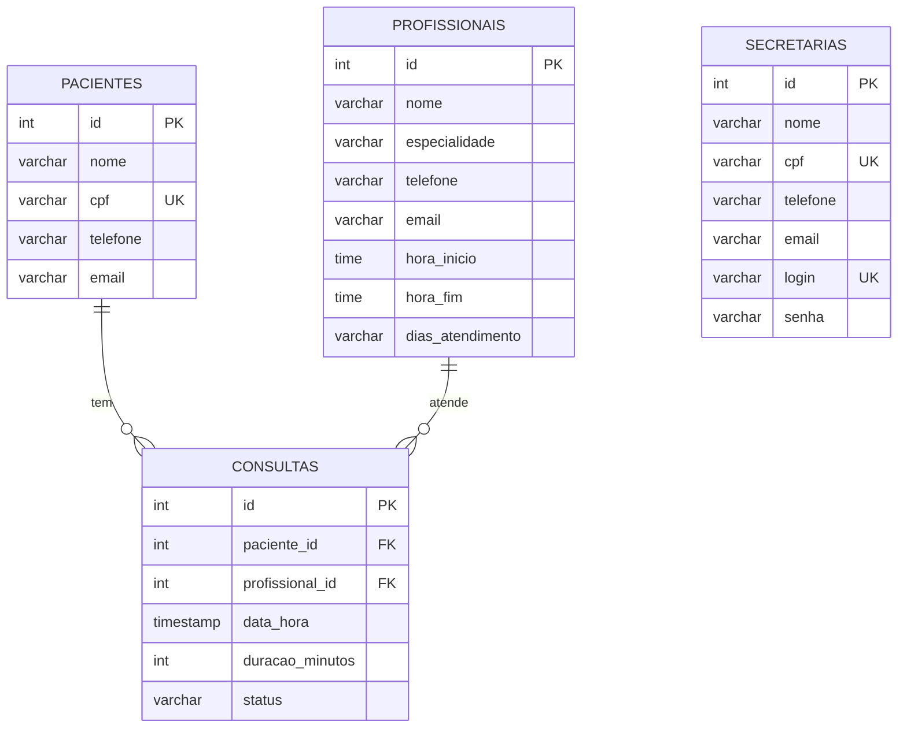

# Modelo de domínio

O sistema tem **4 entidades** e **2 relacionamentos**: uma consulta liga um paciente a um profissional. A secretária é uma entidade independente, usada por quem opera o sistema.

## Entidades

Uma tabela por entidade. A coluna **Regra** é o que vira `NOT NULL`, `UNIQUE` ou validação no DTO.

### Paciente

Pessoa atendida pela clínica.

| Atributo | Tipo TypeScript | Coluna | Obrigatório | Regra |
|---|---|---|---|---|
| `id` | `number` | `id` | sim | Gerado pelo banco (`SERIAL`) |
| `nome` | `string` | `nome` | sim | Até 100 caracteres |
| `cpf` | `string` | `cpf` | sim | Até 14 caracteres. **Único** |
| `telefone` | `string \| null` | `telefone` | não | Até 20 caracteres |
| `email` | `string \| null` | `email` | não | Até 100 caracteres |

### Profissional

Quem atende na clínica, com o expediente em que pode receber consultas.

| Atributo | Tipo TypeScript | Coluna | Obrigatório | Regra |
|---|---|---|---|---|
| `id` | `number` | `id` | sim | Gerado pelo banco |
| `nome` | `string` | `nome` | sim | Até 100 caracteres |
| `especialidade` | `string` | `especialidade` | sim | Até 100 caracteres |
| `telefone` | `string \| null` | `telefone` | não | Até 20 caracteres |
| `email` | `string \| null` | `email` | não | Até 100 caracteres, formato de e-mail válido |
| `horaInicio` | `string` | `hora_inicio` | sim | Tipo `TIME`. Entra e sai como `HH:mm` |
| `horaFim` | `string` | `hora_fim` | sim | Tipo `TIME`. Precisa ser maior que `horaInicio` (DTO e `CHECK` no banco) |
| `diasAtendimento` | `string` (no banco) / `number[]` (na API) | `dias_atendimento` | sim | Dias da semana de 0 (domingo) a 6 (sábado). Pelo menos um dia. No banco fica como texto separado por vírgula (ex.: `"1,2,3,4,5"`); o Mapper remove repetidos e ordena |

### Secretaria

Quem opera o sistema.

| Atributo | Tipo TypeScript | Coluna | Obrigatório | Regra |
|---|---|---|---|---|
| `id` | `number` | `id` | sim | Gerado pelo banco |
| `nome` | `string` | `nome` | sim | Até 100 caracteres |
| `cpf` | `string` | `cpf` | sim | Até 14 caracteres. **Único** (R5) |
| `telefone` | `string \| null` | `telefone` | não | Até 20 caracteres |
| `email` | `string \| null` | `email` | não | Até 100 caracteres, formato de e-mail válido |
| `login` | `string` | `login` | sim | De 3 a 50 caracteres. **Único** (R5) |
| `senha` | `string` | `senha` | sim | De 6 a 100 caracteres na entrada. A coluna comporta 255. Nunca aparece na resposta |

### Consulta

Atendimento marcado entre um paciente e um profissional.

| Atributo | Tipo TypeScript | Coluna | Obrigatório | Regra |
|---|---|---|---|---|
| `id` | `number` | `id` | sim | Gerado pelo banco |
| `paciente` | `Paciente` | `paciente_id` | sim | Chave estrangeira para `pacientes(id)`. Na API entra como `pacienteId` |
| `profissional` | `Profissional` | `profissional_id` | sim | Chave estrangeira para `profissionais(id)`. Na API entra como `profissionalId` |
| `dataHora` | `Date` | `data_hora` | sim | `TIMESTAMP`. Entra como `AAAA-MM-DDTHH:mm:ss`. Sujeita a R1, R2 e R3 |
| `duracaoMinutos` | `number` | `duracao_minutos` | sim | Inteiro de 5 a 480 no DTO. O banco exige maior que 0 (`CHECK`) |
| `status` | `string` | `status` | sim | Nasce `agendada`; o cliente não controla. Só consultas `agendada` entram na checagem de conflito |

## Relacionamentos

| De | Para | Tipo | No banco | No código |
|---|---|---|---|---|
| Consulta | Paciente | muitos para um | `consultas.paciente_id` referencia `pacientes(id)` | `@ManyToOne` + `@JoinColumn` em `Consulta` |
| Consulta | Profissional | muitos para um | `consultas.profissional_id` referencia `profissionais(id)` | `@ManyToOne` + `@JoinColumn` em `Consulta` |

`Secretaria` não tem relacionamento com as outras tabelas: não registra quem agendou cada consulta.

## Diagrama ER

Como ler: `||--o{` é "um para muitos". Um paciente tem zero ou várias consultas, e cada consulta é de exatamente um paciente. O mesmo vale para o profissional. `SECRETARIAS` aparece solta porque não se liga a nenhuma tabela.

## Migrations

Ficam em `src/db/migrations`. O projeto tem **quatro migrations**, uma por tabela, na ordem certa: as tabelas referenciadas (`pacientes`, `profissionais`) nascem antes de `consultas`, que referencia as duas. A ordem de execução vem do timestamp no nome da classe (`1700000000001` a `1700000000004`). O banco só muda por migration nova: nunca se edita uma que já rodou.

| Versão | Arquivo | O que cria |
|---|---|---|
| V1 | `V1_criar_pacientes.ts` | Tabela `pacientes`; `cpf` único |
| V2 | `V2_criar_profissionais.ts` | Tabela `profissionais`; `CHECK` de expediente (`hora_inicio < hora_fim`) |
| V3 | `V3_criar_secretarias.ts` | Tabela `secretarias`; `cpf` e `login` únicos |
| V4 | `V4_consultas.ts` | Tabela `consultas`; as duas chaves estrangeiras (`paciente_id`, `profissional_id`); `CHECK` de duração (`duracao_minutos > 0`); índices `idx_consultas_paciente_horario` e `idx_consultas_profissional_horario`, que aceleram a checagem de conflito de R1 e R3 |

As migrations rodam sozinhas quando a API sobe (`migrationsRun: true`). Os arquivos **precisam ter a extensão `.ts`** (ou `.js` após o build), porque o `config/database.ts` carrega apenas `migrations/*.{ts,js}`; um arquivo sem extensão é ignorado e a tabela não é criada. Logo em seguida, `config/schemaValidator.ts` confere se cada entidade tem a tabela e as colunas esperadas.
